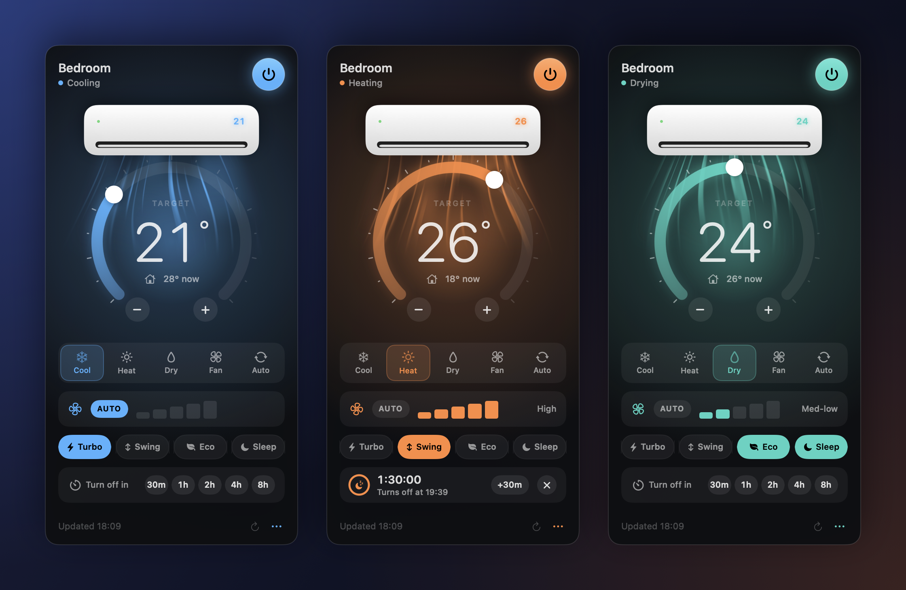
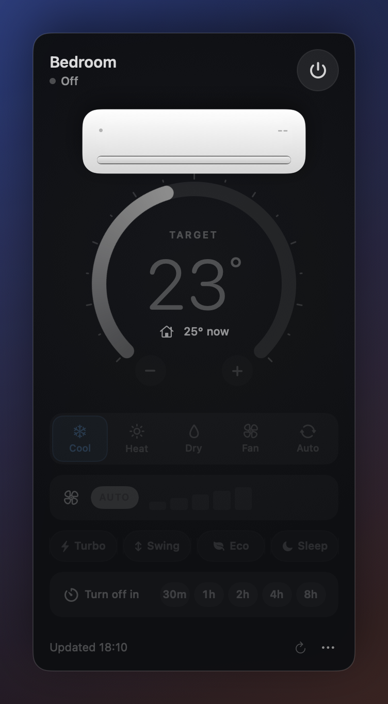
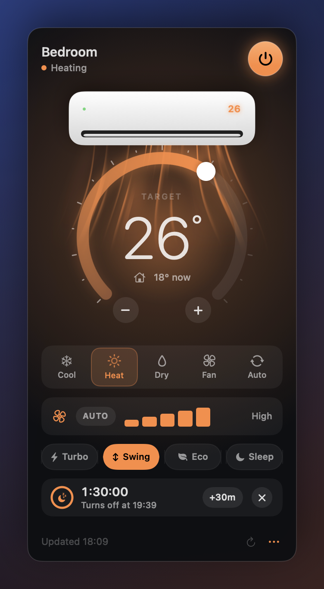

<div align="center">

# Hisense Menubar

**English** · [Português](README.pt-BR.md)

**Control your Hisense (ConnectLife) air conditioner from the Mac menu bar.**

No more hunting for the remote or reaching for your phone.




</div>

## Features

- **Temperature in the menu bar**: shows `23°` when the AC is on, `off` when it's off, and a timer icon while a shutdown is scheduled.
- **Thermostat dial**: drag the ring, click `−`/`+` or press `↑`/`↓`. The trackpad gives a haptic tick on every degree.
- **Animated split unit**: the louver opens when the AC turns on, and a Metal shader draws the airflow down into the dial in the mode's color, as strong as the fan setting.
- **Modes**: Cool, Heat, Dry, Fan and Auto, each with its own color. The active mode's icon "breathes".
- **Fan speed**: a bar meter with Auto plus 5 speeds. The fan icon spins at the selected speed.
- **Extras**: Turbo, Swing, Eco and Sleep. Each one only shows up if your unit reports it.
- **Auto-off timer**: 30m, 1h, 2h, 4h or 8h, with a countdown, `+30m` to postpone and a notification when it fires.
- **Light and native**: a ~1 MB SwiftUI app with no Dock icon. Your password is stored only in the Keychain.
- **English and Portuguese**: the app follows your system language.

| Off | Timer running |
|:---:|:---:|
|  |  |

## Install

Requirements: macOS 14 or later and the Xcode Command Line Tools (`xcode-select --install`). You don't need the full Xcode.

```bash
git clone https://github.com/LuisMFG/hisense-menubar.git
cd hisense-menubar
./build-app.sh
cp -R "build/Ar Condicionado.app" /Applications/
open "/Applications/Ar Condicionado.app"
```

Click the air conditioner icon in the menu bar and sign in with **the same email and password you use in the ConnectLife app**.

To launch it at login, add the app under **System Settings → General → Login Items**.

### Shortcuts (while the panel is open)

| Key | Action |
|---|---|
| `Space` | Turn on/off |
| `↑` / `↓` | +1° / −1° |
| `⌘R` | Refresh status |
| `⌘Q` | Quit |

## How it works

Hisense doesn't publish an API. The app talks to the same cloud the official ConnectLife app uses:

```
Gigya (CDC)          hijuconn OAuth            clife-eu gateway
accounts.login  ──▶  /oauth/authorize    ──▶  /clife-svc/pu/get_device_status_list
accounts.getJWT      /oauth/token              /device/pu/property/set
                                               └─ every request is signed:
                                                  sign = RSA_PKCS1(SHA256(sorted params + suffix))
```

The unit's state comes back as properties (`t_power`, `t_temp`, `t_work_mode`, `t_fan_speed`, `f_temp_in`…), and commands set those same properties. The panel updates right away (optimistically) and syncs with the cloud every 60 s.

## Reverse engineering with REA

I checked the protocol against the official **ConnectLife 2.17.2 (Android)** app with [REA](https://github.com/morluto/rea), a reverse-engineering MCP/CLI for coding agents:

1. `rea extract-artifact` unpacks the `.xapk` into the base APK and the `armeabi-v7a` split.
2. `rea identify-flutter-build` shows the app is **Flutter**, so the logic lives in Dart AOT code (`libapp.so`).
3. `rea inspect-dart-aot` reads the Dart snapshot's string pool. It contains the `air_conditioner` and `gigya_flutter_plugin` modules, a `RSASigner` class, and more.
4. A full scan of the extracted `libapp.so` confirms the endpoints, the signature fields and the property names.

[**REA-FINDINGS.md**](REA-FINDINGS.md) lists what was confirmed, what differs from the reference library (the official `appId`, for example) and what couldn't be extracted (the `appSecret` and RSA key are obfuscated). That file is written in Portuguese.

## Project layout

```
Sources/ArCondicionado/
├── ConnectLifeAPI.swift   # Gigya login → OAuth → signed gateway (SHA256 + RSA)
├── ACStore.swift          # state, optimistic commands, timer, Keychain
├── Views.swift            # panel: dial, modes, fan speed, chips, timer
├── Effects.swift          # glass, Metal airflow shader, split unit, haptics
└── App.swift              # MenuBarExtra
Resources/*.lproj/         # translations (en, pt-BR)
Snapshot/                  # renders the README images from mock data
build-app.sh               # builds and packages the .app
snapshot.sh                # ./snapshot.sh → docs/*.png (en) and docs/pt-BR/*.png
```

The Metal shader is compiled when the app launches (`makeLibrary(source:)`), so the project builds with just the Command Line Tools.

## Limitations

- **The timer runs on the Mac.** While it's armed, the Mac won't idle-sleep. If you close the lid, though, the AC only turns off once the Mac wakes up again. The official app schedules in the cloud (`/energy-service/api/device/saveScheduler`), but that payload hasn't been mapped yet.
- **Tested** with one Hisense split unit on a Brazilian account. Other models may expose different properties. The extra functions only appear when your unit reports them.
- **Unofficial.** The cloud API can change at any time and break the app.

## Credits

- [oyvindwe/connectlife](https://github.com/oyvindwe/connectlife), an open-source Python client for the ConnectLife cloud. This project uses the same client credentials and signing algorithm.
- [morluto/rea](https://github.com/morluto/rea), used to verify the protocol against the official app.

## Disclaimer

This is a personal project and is **not affiliated** with Hisense or ConnectLife. Use it at your own risk. Your ConnectLife password stays in your Mac's Keychain and is only sent to ConnectLife's own sign-in servers (Gigya).

## License

[GPL-3.0](LICENSE)
